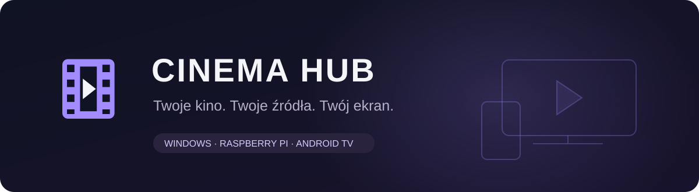
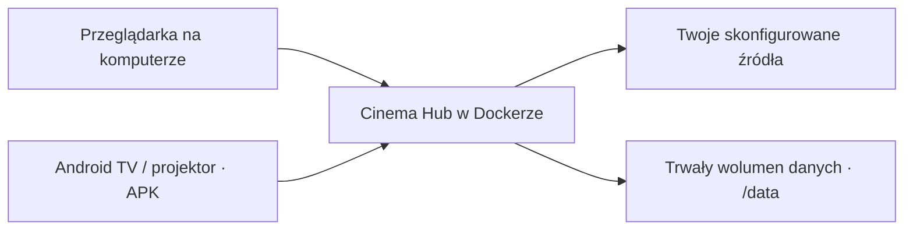

<p align="center"></p>

<p align="center">


</p>

# Cinema Hub

**Twoje kino w jednym miejscu.** Prywatny panel filmów i seriali, własne źródła mediów oraz klient Android TV z obsługą pilota. Serwer działa w kontenerze na Windows lub Raspberry Pi; telewizor łączy się z nim przez sieć.

Każde konto ma własne logowania do źródeł, ustawienia, ulubione, historię oglądania i kolejkę ręcznego zapisu. Repozytorium zawiera kod aplikacji i gotowy klient APK, bez filmów oraz danych użytkowników.

<p align="center"><a href="https://github.com/hattimon/CINEMA-HUB/releases/latest"><strong>Pobierz najnowsze wydanie</strong></a> · <a href="docs/INSTALL.md">Instalacja Docker</a> · <a href="docs/ANDROID-TV.md">Android TV i pilot</a> · <a href="docs/SOURCES.md">Konfiguracja źródeł</a></p>

## Instalacja jednym kliknięciem przez DCC

Cinema Hub jest dostępny w katalogu aplikacji **[Docker Control Center (DCC)](https://github.com/hattimon/DCC)**, w kategorii **Media**.

Wybierz host Docker na Windows lub Linux, otwórz sklep aplikacji i kliknij **SKLEP → Media → Cinema Hub → Instaluj**. DCC uruchomi aplikację w kontenerze bez ręcznego wpisywania parametrów. Na Windows wymagany jest działający Docker Desktop w trybie kontenerów Linux. Możesz także wybrać obsługiwany host zdalny, np. Raspberry Pi z systemem 64-bit i Dockerem.

**[Strona aplikacji i zrzuty ekranu](https://hattimon.github.io/CINEMA-HUB/)** · **[DCC — pobieranie i instrukcja](https://github.com/hattimon/DCC)**

## Co oferuje aplikacja

| Funkcja | Opis |
| --- | --- |
| Wspólny katalog | Filmy i seriale z wybranych źródeł, opisy, okładki i dostępne filtry |
| Własne źródła | Filman, opcjonalny Vider.info / Vider.pl, Przystań, Plex, HTTP/Nginx, FTP/FTPS, WebDAV, S3 i pliki urządzenia |
| Osobne ustawienia | Adres i logowanie każdego źródła; katalog początkowy i podfoldery Przystani; usuwanie konfiguracji z potwierdzeniem |
| Odtwarzanie | Sprawdzone strumienie MP4/HLS; preferencje języka, jakości i hostingu |
| Android TV | Pilot, natywny odtwarzacz Media3, pełny ekran, sezony i kolejne odcinki |
| Twój profil | Ulubione, „Chcę obejrzeć”, „Kontynuuj” i synchronizacja postępu |
| Ręczny zapis | Pobieranie na urządzenie lub do własnego WebDAV, FTP albo S3 |
| Logowanie | Oddzielna przeglądarka źródła, ręczna CAPTCHA, lokalne odzyskiwanie hasła i opcjonalny TOTP |

## Wybierz platformę

| Platforma | Co instalujesz | Domyślny panel |
| --- | --- | --- |
| Windows | Docker Desktop z kontenerami Linux + Cinema Hub | `http://localhost:8090/` |
| Raspberry Pi | Docker na systemie 64-bit ARM64 + Cinema Hub | `http://IP_RASPBERRY_PI:9999/` |
| Android TV / Google TV | [CinemaHub-AndroidTV-v1.3.2.apk](https://github.com/hattimon/CINEMA-HUB/releases/latest) | Wpisujesz IP i port wybranego serwera |

APK **1.3.2** współpracuje z serwerem **1.3.5**. Pobiera aktualny panel z serwera, więc poprawki katalogu i źródeł nie wymagają każdorazowej instalacji nowego APK.

## Szybki start

Pobierz paczkę `CinemaHub-Server-v1.3.5.zip` z [Releases](https://github.com/hattimon/CINEMA-HUB/releases/latest) i rozpakuj ją albo sklonuj repozytorium:

```sh
git clone https://github.com/hattimon/CINEMA-HUB.git
cd CINEMA-HUB
```

**Windows — PowerShell:**

```powershell
.\install-windows.ps1
```

**Raspberry Pi — terminal:**

```sh
sh install-raspberry-pi.sh
```

Instalatory tworzą lokalny plik `.env` z losowym hasłem startowego konta **admin**, jeśli plik jeszcze nie istnieje. Hasło odczytasz z pola `INITIAL_ADMIN_PASSWORD` w swoim `.env`. Konto startowe jest tworzone tylko dla nowej bazy. Gotowy obraz pochodzi z `ghcr.io/hattimon/cinema-hub:1.3.5`; możesz też zbudować go lokalnie: Windows `-Build`, Pi `--build`.

Pełna instrukcja, porty, aktualizacje i kopie danych: **[Instalacja i utrzymanie](docs/INSTALL.md)**.

## Jak to działa



Wideo przesyłane jest strumieniowo. Pobieranie rozpoczyna się po kliknięciu użytkownika. Źródło musi być osiągalne **z hosta i kontenera serwera**, także gdy APK działa na innym urządzeniu. Pliki powinny mieć kodeki obsługiwane przez odtwarzacz, np. H.264/AAC w MP4.

## Dokumentacja

- [Instalacja Windows i Raspberry Pi, aktualizacja, kopie danych](docs/INSTALL.md)
- [Android TV, Magcubic L018 i obsługa pilota](docs/ANDROID-TV.md)
- [Vider, Przystań i pozostałe źródła](docs/SOURCES.md)
- [Budowanie i testowanie kodu](docs/DEVELOPMENT.md)
- [Historia wydania 1.3.5](CHANGELOG.md)

Integracja Vider obsługuje aktualne adresy `vider.info` i `vider.pl`. Sesję logowania należy utworzyć w **Ustawienia → Źródła → Zaloguj / CAPTCHA**. Dostępność zewnętrznych portali, wymagane logowanie i ograniczenia transferu zależą od źródła. CAPTCHA rozwiązuje użytkownik; aplikacja nie omija DRM ani płatnego dostępu.

## Układ repozytorium

```text
server/                API, adaptery źródeł i weryfikacja mediów
src/                   panel React / TypeScript
android/               kod klienta Android TV
releases/              gotowy APK
docs/                  instalacja i konfiguracja
Dockerfile             budowa kontenera amd64 / arm64
Dockerfile.pi          wariant z wcześniej zbudowanym panelem
compose.yaml           konfiguracja Windows / Linux
compose.pi.yaml        profil Raspberry Pi
```

**Autor i repozytorium:** [hattimon / CINEMA-HUB](https://github.com/hattimon/CINEMA-HUB)
